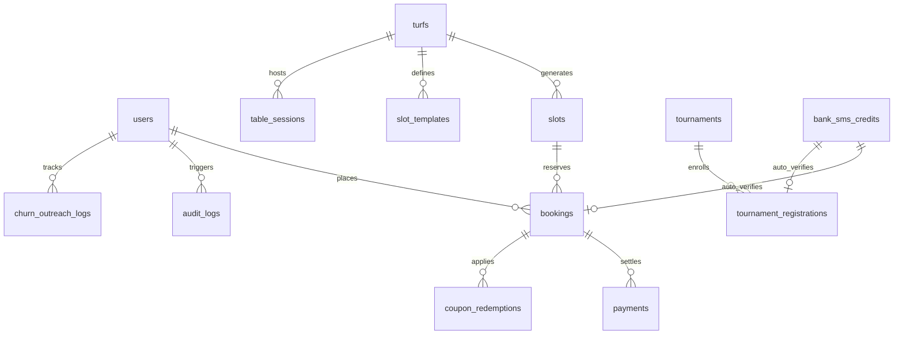

# SHRI TRIMURTI FITNESS CLUB (Turfbook Pro) — Complete Project Documentation

> **Status:** Production-Ready Full-Stack Web Platform, Progressive Web App (PWA) & Autonomous AI Agentic System  
> **Location:** Akola, Maharashtra, India  
> **Primary Domains:** Multi-Sport Arena Management, Turf & Table Slot Reservations, AI Payment Verification, Missed-Call & WhatsApp Conversational Booking, Bank SMS Auto-Verification, Smart Churn Retention Predictor, Weekly Business Intelligence Executive Summaries, Tournament Operations, Staff Floor Scanner, Financial Analytics, and Social Marketing Automation.

---

## 1. Executive Summary

**SHRI TRIMURTI FITNESS CLUB** (internally code-named **Turfbook Pro** / **TurfZone**) is a production-grade sports facility management and autonomous booking platform built specifically for contemporary multi-sport complexes. The system serves three primary user personas:

1. **Customers:**
   - Browse facilities, view real-time live court availability, book Cricket and Football turfs or snooker/pool tables.
   - Contact verification via dual WhatsApp Phone OTP or Email OTP.
   - Multi-channel booking: Responsive Web App, 2-Way Conversational WhatsApp Bot, or 1-Ring Missed-Call Instant Booking.
   - 0%-fee Direct Arena UPI with UTR entry or instant Vision AI payment screenshot OCR verification.
   - Live socket auto-approval with 15-minute slot hold guarantee and real-time gate pass issuance.
   - Download verifiable digital entry passes with cryptographic QR codes, calculate team cost-splits, and share passes directly to WhatsApp squads.

2. **On-Site Staff:**
   - Quick-login on mobile or tablet terminals via a 6-digit numeric PIN.
   - Camera-based high-speed HTML5 QR scanner for frictionless gate check-in.
   - Real-time on-court presence tracking and live waitlist management.
   - 1-tap on-the-spot match extensions (+1 hour) with slot availability collision guards.
   - Stopwatch-based ad-hoc table session management for snooker and pool with automated billing.

3. **Arena Administrators & Owners:**
   - Manage dynamic tiered pricing (weekday/weekend, daytime/night lights).
   - Real-time venue occupancy tracking via the **Live Occupancy Pulse**.
   - **Bank SMS Auto-Verification Engine:** Automatically verifies UPI payments directly from Android bank SMS alerts (SBI, Bank of Maharashtra, HDFC, Axis, etc.) and auto-approves slots in < 3 seconds.
   - **1-Tap WhatsApp Verification:** Approve or reject bookings directly from phone notifications with secure HMAC short-links.
   - **Smart Churn & Retention Predictor:** Weekly automated detection of inactive regular teams, live weekend slot check, and 1-tap WhatsApp invitations.
   - **Weekly Business Intelligence Brief:** Every Monday at 8:00 AM, delivers a C-suite WhatsApp summary of 7-day revenue, sport split, dead-zone slot monetization, and player sentiment.
   - Full coupon and discount engine, operational expense logging, tournament management, staff RBAC permissions, and immutable audit logs.
   - Automated Instagram Story marketing poster generation via the **Ad Studio**.

---

## 2. Architecture & Technology Stack

The platform is designed as an event-driven, decoupled client-server architecture with high availability, real-time WebSockets synchronization, and serverless database cost optimization.

```
┌────────────────────────────────────────────────────────────────────────┐
│                        CLIENT / FRONTEND                               │
│  React 18 + TypeScript + Vite + Tailwind CSS + Shadcn/Radix UI        │
│  State & Data: TanStack React Query + Custom Hooks                     │
│  Realtime: Socket.io Client (Live auto-approval & presence)            │
│  PWA: vite-plugin-pwa (Workbox Service Worker + Offline Storage)       │
└───────────────────▲────────────────────────────────┬───────────────────┘
                    │                                │
          HTTP/REST │ (Axios + JWT)                  │ WebSockets (Socket.io)
                    ▼                                ▼
┌────────────────────────────────────────────────────────────────────────┐
│                        SERVER / BACKEND                                │
│  Node.js (v18+) + Express.js (v5)                                      │
│  Security: Helmet, Compression, Morgan, Redis Rate Limiting            │
│  Authentication: Stateless JWT + Token Versioning + bcryptjs PIN/Pass │
│  Realtime Engine: Socket.io Event Broadcaster                          │
│  Cache Layer: Redis (ioredis) with Cache-Aside & Pattern Invalidation   │
│  AI Engine: Google Gemini 3.5 Flash (Vision OCR, BI Synthesis, Copy)  │
└─────────┬──────────────────────┬───────────────────────┬───────────────┘
          │                      │                       │
          ▼                      ▼                       ▼
┌──────────────────┐   ┌──────────────────┐    ┌─────────────────────────┐
│   POSTGRESQL     │   │   REDIS CACHE    │    │  THIRD-PARTY & IOT      │
│   Neon Database  │   │   (ioredis)      │    │  • Meta WhatsApp Cloud  │
│  • 24 Relational │   │  • Query caching │    │  • MacroDroid Webhooks  │
│    Tables        │   │  • Rate limiting │    │  • cron-job.org Trigger │
│  • PL/pgSQL JIT  │   │  • Graceful DB   │    │  • Razorpay Gateway     │
│    Functions     │   │    fallback      │    │  • Brevo / Resend Mail  │
│  • Full Text/MODE│   │                  │    │  • Cloudinary Media     │
└──────────────────┘   └──────────────────┘    └─────────────────────────┘
```

### 2.1 Frontend Stack
- **Framework:** React 18.3.1 with TypeScript 5.8.3
- **Bundler & Tooling:** Vite 5.4.19 (with `@vitejs/plugin-react-swc`)
- **Routing:** `react-router-dom` v6.30.1 with role-based route guards
- **Styling:** Tailwind CSS 3.4.17, `tailwind-merge`, `clsx`, `tailwindcss-animate`
- **UI Component Primitives:** Radix UI (`@radix-ui/react-*`), Shadcn UI design patterns
- **Data Fetching & State:** `@tanstack/react-query` v5.83.0
- **Forms & Validation:** `react-hook-form` v7.61.1 with `zod` schema validation
- **Animations:** `framer-motion` v12.38.0
- **QR Scanning & Generation:** `html5-qrcode` v2.3.8 (camera scanner), `qrcode.react` v4.2.0 (SVG generator)
- **Visual Analytics:** `recharts` v3.8.1 (Bar, Area, Pie charts)
- **Exporting & Capture:** `html-to-image` v1.11.13 (Instagram Story ad generation)
- **Realtime:** `socket.io-client` v4.8.3 with custom `useSocket` reactive hooks
- **Progressive Web App:** `vite-plugin-pwa` v1.2.0 with Workbox runtime caching
- **Feedback & Notifications:** `sonner` v1.7.4 and `canvas-confetti` v1.9.4

### 2.2 Backend Stack
- **Runtime & Web Framework:** Node.js v18+ with Express.js v5.2.1
- **Database Client:** `pg` (v8.20.0) with pooled connections optimized for serverless PostgreSQL (Neon)
- **Caching & Ephemeral Store:** Redis via `ioredis` (v5.10.1) with in-memory fallback
- **Real-Time Engine:** Socket.io (v4.8.3) with channel broadcasting
- **AI & Computer Vision:** Google Gemini 3.5 Flash (`@google/genai` & REST) for Vision OCR, Sentiment Clustering, and Executive Reporting
- **Security & Middlewares:**
  - `helmet` (v8.1.0) for HTTP header hardening
  - `compression` (v1.8.1) for gzip response compression
  - `express-rate-limit` (v8.3.2) & `rate-limit-redis` (v4.3.1) for IP throttling
  - `cors` (v2.8.6) with dynamic origin checker
  - `jsonwebtoken` (v9.0.3) for stateless authentication
  - `bcryptjs` (v3.0.3) for password and PIN hashing
- **File & Media Storage:** Cloudinary via `multer` (v1.4.5) & `multer-storage-cloudinary` (v4.0.0)
- **Payment Processing:** `razorpay` (v2.9.6) with SHA-256 HMAC signature verification
- **Messaging & Notifications:** Meta WhatsApp Cloud API (Graph v21.0), Brevo (Sendinblue) REST API, and Resend (v6.12.2)

---

## 3. Directory & File Structure

```
ShriTrimurtiFitness/
├── database_schema.sql            # Master PostgreSQL DDL schema definition
├── DOCUMENTATION.md               # Quick technical brief
├── README.md                      # Public repository readme
├── PROJECT.md                     # Master architectural documentation
├── package.json                   # Root monorepo convenience scripts
├── .gitignore                     # Monorepo git ignore rules
│
├── frontend/                      # React 18 + Vite + TypeScript Client
│   ├── package.json               # Frontend dependencies and Vite build scripts
│   ├── vite.config.ts             # Bundler config, PWA manifest & Workbox rules
│   ├── tailwind.config.ts         # Custom colors (turf neon green), font families, animations
│   ├── tsconfig.json              # TypeScript configuration
│   ├── index.html                 # Single page application HTML entry
│   ├── public/                    # Static public assets (manifest, robots, logos)
│   └── src/                       # Frontend source code
│       ├── main.tsx               # React root entry point
│       ├── App.tsx                # Route definitions, ThemeProvider, QueryClient
│       ├── index.css              # Global CSS, Tailwind utilities, custom scrollbars
│       ├── assets/                # Facility pictures, turf backgrounds, brand logo
│       ├── hooks/                 # Custom React hooks (useSocket, useToast, useMobile)
│       ├── lib/                   # Utility libraries (api, utils, whatsapp, mock-data)
│       ├── components/            # Reusable UI components
│       │   ├── AdminLayout.tsx    # Responsive admin sidebar & tab navigation
│       │   ├── AdminWhatsAppModal.tsx # Admin 1-click customer WhatsApp notifier
│       │   ├── landing/           # Landing page sections (Hero, Facilities, Pricing, etc.)
│       │   ├── admin/             # LiveOccupancyPulse, LivePresence, AdminDateFilter
│       │   └── ui/                # 40+ Shadcn atomic UI components
│       └── pages/                 # Routed view components
│           ├── Index.tsx          # Public landing homepage
│           ├── BookingPage.tsx    # 5-step booking wizard with anxiety reduction & socket sync
│           ├── MyBookings.tsx     # Mobile number lookup for active/past passes
│           ├── TournamentDetails.tsx
│           ├── TournamentRegistrationDialog.tsx
│           ├── StaffLogin.tsx     # Tablet-friendly 6-digit numeric PIN entry
│           ├── AdminLogin.tsx     # Administrator email + password portal
│           └── admin/             # 22+ Administrative control screens
│               ├── AdminDashboard.tsx
│               ├── AdminBookings.tsx      # Table & cards with Auto-Verified (Bank SMS) badges
│               ├── AdminCalendar.tsx
│               ├── AdminSlots.tsx
│               ├── AdminTables.tsx
│               ├── AdminSchedules.tsx
│               ├── AdminFacilities.tsx
│               ├── AdminTournaments.tsx
│               ├── AdminTournamentRegistrations.tsx
│               ├── AdminAnalytics.tsx     # Includes Weekly Executive Intelligence briefs
│               ├── AdminRetention.tsx     # Squad Churn & Retention Predictor UI
│               ├── AdminFinance.tsx
│               ├── AdminCoupons.tsx       # Discount codes & promo engine
│               ├── AdminAdStudio.tsx      # Instagram Story poster generator
│               ├── AdminPricing.tsx
│               ├── AdminGallery.tsx
│               ├── AdminTestimonials.tsx
│               ├── AdminClosures.tsx
│               ├── AdminAuditLogs.tsx
│               ├── AdminStaff.tsx
│               └── AdminSettings.tsx
│
└── backend/                       # Node.js Express REST API server
    ├── package.json               # Backend dependencies and node scripts
    ├── server.js                  # Express entry point, socket initialization, auto-migrations
    ├── config/                    # Infrastructure configurations (db, redis, cache, cloudinary)
    ├── middleware/                # Express middleware (auth, rateLimiter)
    ├── routes/                    # Modular API route controllers
    │   ├── auth.js                # Login, PIN auth, staff profiles, password reset
    │   ├── bookings.js            # Slot booking, UPI submission, QR verification, quick verify
    │   ├── slots.js               # JIT slot generator and live availability
    │   ├── facilities.js          # Facility CRUD, table counts, cover uploads
    │   ├── payments.js            # Razorpay orders, Bank SMS webhook (/bank-sms)
    │   ├── whatsapp.js            # Meta webhook, missed-call trigger (/missed-call)
    │   ├── retention.js           # Churn analysis cron trigger (/churn-analysis) & logs
    │   ├── coupons.js             # Coupon validation and redemption tracking
    │   ├── analytics.js           # Analytics stats, settle-up, weekly executive summary
    │   ├── tournaments.js         # Tournament management & registrations
    │   ├── sessions.js            # Ad-hoc snooker/pool stopwatch sessions
    │   ├── expenses.js            # Operational overhead logging
    │   ├── closures.js            # Dynamic facility & global arena closures
    │   ├── gallery.js             # Media asset management
    │   ├── testimonials.js        # Customer review moderation
    │   ├── staff.js               # Staff accounts & RBAC management
    │   └── settings.js            # Arena contact, UPI ID, QR, and tax settings
    ├── services/                  # Specialized autonomous engines
    │   ├── whatsapp.js            # WhatsApp Cloud API client (text, image, interactive)
    │   ├── whatsappBot.js         # Conversational booking bot & state machine
    │   ├── adminBookingService.js # 1-tap admin action links, passes, notifications
    │   ├── receiptOcrService.js   # Gemini 3.5 Flash Vision OCR for payment screenshots
    │   ├── bankSmsParser.js       # Fast regex + Gemini fallback parser for bank SMS
    │   ├── bankSmsMatchingService.js # 2-way matching engine for UPI payments
    │   ├── retentionService.js    # SQL churn detection + Gemini personalized copywriting
    │   ├── weeklyBiService.js     # 7-day SQL financial aggregations + executive synthesis
    │   └── notificationScheduler.js # Match reminders and post-match feedback surveys
    └── utils/                     # Utility modules (dual-provider mailer, phone normalizer)
```

---

## 4. Database Schema & Entities

The relational database is architected in PostgreSQL with `uuid-ossp` extensions for secure, non-sequential identifiers.



### 4.1 Master Data Dictionary

| Table Name | Primary Key | Description & Key Columns |
|---|---|---|
| `users` | `id` (UUID) | Admin, staff, and customer accounts. Columns: `name`, `email`, `phone`, `password_hash`, `role` (`user`, `admin`, `staff`), `pin_hash` (6-digit PIN), `token_version` (logout invalidation), `allowed_tabs` (RBAC access array). |
| `turfs` | `id` (UUID) | Physical and digital facilities. Columns: `name`, `facility_type` (`cricket`, `football`, `snooker`, `pool`), `pricing_model` (`slot` or `hourly`), `weekday_day_price`, `weekday_night_price`, `weekend_day_price`, `weekend_night_price`, `table_count`, `opening_hour`, `closing_hour`, `physical_resource_id`, `is_active`. |
| `slot_templates` | `id` (UUID) | Weekly recurring master schedule rules. Columns: `turf_id`, `day_of_week` (0-6), `start_time`, `end_time`, `price`. |
| `slots` | `id` (UUID) | Concrete bookable hourly time units. Columns: `turf_id`, `date`, `start_time`, `end_time`, `price`, `table_number`, `is_available`. |
| `bookings` | `id` (UUID) | Customer reservations. Columns: `user_id`, `slot_id`, `status` (`pending`, `pending_verification`, `confirmed`, `cancelled`, `rejected`, `completed`), `payment_status` (`pending`, `paid`, `refunded`), `paid_amount`, `remaining_amount`, `payment_mode` (`cash`, `upi_qr`, `bank_sms`, `online`), `qr_token` (UUID entry pass), `checked_in_at`, `is_manual`, `utr_number`, `coupon_code`, `discount_amount`, `feedback_rating`, `feedback_comment`. |
| `payments` | `id` (UUID) | Granular financial transactions. Columns: `booking_id`, `amount`, `method` (`online`, `cash`, `upi_qr`, `bank_sms`), `platform_fee`, `is_settled`, `razorpay_order_id`, `razorpay_payment_id`. |
| `bank_sms_credits` | `id` (UUID) | Unused & matched bank SMS ledger. Columns: `amount`, `utr_number`, `last4`, `raw_sms`, `sender`, `is_used`, `matched_booking_id`, `matched_registration_id`, `expires_at`, `created_at`. |
| `churn_outreach_logs` | `id` (UUID) | Customer retention outreach ledger. Columns: `user_id`, `customer_name`, `customer_phone`, `total_past_matches`, `preferred_day_of_week`, `preferred_time`, `target_date`, `target_slot_id`, `slot_status` (`open`, `alternative`, `general`), `generated_message`, `status` (`drafted`, `sent`, `converted`, `snoozed`), `created_at`, `dispatched_at`. |
| `weekly_executive_summaries` | `id` (UUID) | Weekly business intelligence briefs. Columns: `period_start`, `period_end`, `total_revenue`, `previous_revenue`, `growth_percentage`, `cricket_revenue`, `football_revenue`, `matches_count`, `unique_teams_count`, `peak_occupancy_pct`, `dead_zone_occupancy_pct`, `unbooked_afternoon_slots`, `average_rating`, `star_team_name`, `star_team_matches`, `raw_data_json`, `generated_summary_text`, `dispatched_to_admin`, `created_at`. |
| `coupons` | `id` (UUID) | Promo codes & discounts. Columns: `code`, `discount_type` (`flat`, `percent`), `discount_value`, `min_booking_amount`, `max_discount`, `is_first_booking_only`, `total_usage_limit`, `per_user_limit`, `used_count`, `valid_from`, `valid_until`, `is_active`. |
| `coupon_redemptions` | `id` (UUID) | Tracks coupon usage history. Columns: `coupon_id`, `booking_id`, `customer_phone`, `discount_amount`, `final_paid_amount`, `created_at`. |
| `table_sessions` | `id` (UUID) | Stopwatch timer sessions for snooker/pool. Columns: `turf_id`, `name`, `table_number`, `customer_name`, `customer_phone`, `start_time`, `end_time`, `total_amount`, `payment_mode`, `status` (`running`, `completed`, `cancelled`), `is_settled`. |
| `arena_closures` | `id` (SERIAL) | Maintenance/holiday blocks. Columns: `date` (UNIQUE), `reason`, `turf_id` (NULL = global). |
| `tournaments` | `id` (UUID) | Competitive events. Columns: `name`, `sport_type`, `description`, `rules`, `entry_fee`, `prize`, `start_date`, `end_date`, `max_teams`, `banner_image`, `is_featured`, `show_on_homepage`, `display_priority`, `is_active`. |
| `tournament_registrations` | `id` (UUID) | Team tournament enrollments. Columns: `tournament_id`, `team_name`, `captain_name`, `phone`, `email`, `payment_status`, `utr_number`, `payment_mode`, `rejection_reason`. |
| `otp_verifications` | `id` (SERIAL) | 4-digit verification codes. Columns: `email`, `phone`, `otp_code`, `expires_at`, `verified`. |
| `expenses` | `id` (UUID) | Operational costs. Columns: `category` (Equipment, Utilities, Maintenance, Salary), `amount`, `description`, `expense_date`. |
| `site_settings` | `id` (INT = 1) | Arena configuration singleton. Columns: `address`, `phone`, `email`, `working_hours`, `google_rating`, `google_reviews_count`, `google_maps_url`, `gateway_percent`, `gst_percent`, `upi_id`, `upi_qr_url`, `show_testimonials`. |
| `gallery_images` | `id` (UUID) | Media assets. Columns: `cloudinary_url`, `public_id`, `alt_text`, `span_type`, `sort_order`, `resource_type`. |
| `testimonials` | `id` (UUID) | Customer feedback. Columns: `name`, `role`, `text`, `rating`, `status`, `is_featured`. |
| `pricing_plans` | `id` (UUID) | Marketing cards. Columns: `name`, `subtitle`, `price`, `unit`, `features`, `popular`, `facility`, `sort_order`. |
| `audit_logs` | `id` (UUID) | Immutable audit trails. Columns: `admin_id`, `action`, `details`, `created_at`. |
| `password_resets` | `id` (SERIAL) | Password recovery tokens. Columns: `user_id`, `token`, `expires_at`. |
| `whatsapp_logs` | `id` (UUID) | Message dispatch tracking. Columns: `phone`, `template_name`, `status`, `response`. |

---

## 5. Core Autonomous AI & Business Workflows

### 5.1 Bank SMS Auto-Verification Engine (Zero Manual Checking)
Eliminates manual admin approval for UPI payments:
1. When a player pays via GPay, PhonePe, or Paytm, the venue Android phone receives a bank credit SMS (e.g., from SBI, Bank of Maharashtra, HDFC, or Axis).
2. **MacroDroid** captures the SMS and posts it to `POST /api/payments/bank-sms`.
3. The hybrid parser (`bankSmsParser.js`) validates the credit, strictly rejects debits/withdrawals, and extracts `{ amount, utr, last4, bank }` via fast regex (with Gemini 3.5 Flash fallback).
4. **Two-Way Matching & Race Condition Handling**:
   - **Case A (Customer submits first $\rightarrow$ SMS arrives second)**: Locates the pending booking matching `amount == paid_amount` AND `utr endsWith last4`. Auto-approves the booking, generates the cryptographic QR pass, turns the web booking screen green via Socket.io, sends the entry pass to the customer's WhatsApp, and alerts the admin.
   - **Case B (SMS arrives first $\rightarrow$ Customer submits second)**: Caches the bank credit in `bank_sms_credits` (30-minute validity). When the player submits their UTR, the fast-path check matches the pre-cached credit and approves the booking **on the spot**.
5. **Unrelated Payment Protection**: Personal transfers or canteen payments are isolated in the ledger and will never confirm a turf booking unless the UTR matches.

### 5.2 Vision AI Payment Screenshot OCR
- Customers who book via WhatsApp or mobile don't need to manually type 12-digit numbers.
- When an image receipt is received, `receiptOcrService.js` routes it to **Gemini 3.5 Flash Vision**.
- The model extracts the 12-digit UTR, last 4 digits, payment app name, and amount paid.
- Automatically initiates verification and notifies the customer: *"📸 Payment Screenshot Verified! Detected UPI Ref ID ending in 2715 via PhonePe."*

### 5.3 1-Ring Missed-Call Instant Booking Agent
- When a customer calls the venue phone and hangs up (or call drops):
- MacroDroid detects the call state and hits `POST /api/whatsapp/missed-call` with the caller's number.
- The WhatsApp bot instantly delivers an interactive greeting with quick-action buttons:
  - `[🏏 Cricket Slots]`
  - `[⚽ Football Slots]`
  - `[💰 Rates & Pricing]`
  - `[📍 Venue Directions]`

### 5.4 Smart Churn & Squad Retention Predictor
- Runs on a scheduled trigger via **cron-job.org** (`POST /api/retention/churn-analysis`) every **Thursday at 11:00 AM IST** (`0 11 * * 4`).
- **Deterministic SQL Detection**: PostgreSQL uses `MODE() WITHIN GROUP` to find regular teams ($\ge 2$ bookings) who haven't played in the last 10–35 days and have no future bookings.
- Extracts their favorite day of the week (e.g. Saturday), favorite time (e.g. 8:00 PM), and favorite facility.
- Checks live slot availability for the upcoming weekend.
- Enforces a strict **21-day anti-spam cooldown** tracked in `churn_outreach_logs`.
- **Gemini 3.5 Flash** crafts a polite, natural Hinglish greeting ("Namaskar Captain!").
- Delivers a compiled **Thursday Admin WhatsApp Digest** with pre-filled 1-tap `wa.me` links.
- **Conversion Hook**: If the captain replies *"yes"*, *"book"*, or *"karo book"*, the WhatsApp bot locks the slot, marks the outreach as `converted`, and sends the UPI QR code!

### 5.5 Automated Weekly Turf Business Intelligence (Executive Summary)
- Runs on a scheduled trigger via **cron-job.org** (`POST /api/analytics/weekly-executive-summary`) every **Monday at 8:00 AM IST** (`0 8 * * 1`).
- **The 4 Metric Pillars (Deterministic SQL)**:
  1. *Financial Health*: Total Revenue, Cricket Turf vs Football Turf split, Week-over-Week Growth %, and best revenue day.
  2. *Dead-Zone Slot Opportunity*: Peak hours occupancy % vs weekday afternoon (12 PM – 4 PM) occupancy %, and count of vacant daytime slots.
  3. *Ground Sentiment & Maintenance*: Average rating out of 5.0, plus AI clustering of maintenance issues (water dispenser, lighting, netting) from customer feedback comments.
  4. *Squad Activity*: Total matches, unique teams, new first-time teams, and Star Team of the week.
- **Gemini 3.5 Flash** synthesizes these verified numbers into a concise C-suite briefing delivered directly to the owner's WhatsApp.
- Preserved in `weekly_executive_summaries` and viewable under `/admin/analytics`.

### 5.6 1-Tap Secure Admin Action Links
- When a customer submits a manual booking or tournament registration:
- Admin receives an alert on WhatsApp with instant 1-tap action buttons.
- Micro compact URLs (`/v/a/<code>/<token>` for approve, `/v/r/<code>/<token>` for reject) use SHA-256 HMAC verification.
- Admin can approve payments from any smartphone lock screen without logging into the admin portal.

### 5.7 Shared Physical Resource Management
- In multi-sport facilities, Cricket Turf and 5-a-side Football Turf share the same physical ground.
- Both facilities carry an identical `physical_resource_id` (e.g. `1`).
- When an hour is booked on Cricket, the availability queries automatically lock the overlapping slot on Football, preventing physical double-booking while tracking independent metrics for each sport.

### 5.8 Dynamic Coupon & Discount Engine
- Supports flat (₹) and percentage (%) discounts with floor price protection (minimum ₹300 payable to prevent losses).
- Restricts coupons to first-time bookings, sets minimum booking thresholds, and enforces per-user and global usage limits.

---

## 6. Complete API Reference

All routes are mounted under `/api`.

### 6.1 Payments & Bank SMS (`/api/payments`)
| Method | Endpoint | Auth | Description |
|---|---|---|---|
| `POST/GET` | `/payments/bank-sms` | Secret | MacroDroid webhook for incoming bank credit SMS |
| `GET` | `/payments/bank-credits` | Bearer | Admin ledger of captured bank SMS credits |
| `POST` | `/payments/create-order` | Public | Create Razorpay order with platform fee calculation |
| `POST` | `/payments/verify` | Public | Verify Razorpay SHA-256 HMAC signature |

### 6.2 WhatsApp Bot & Missed Calls (`/api/whatsapp`)
| Method | Endpoint | Auth | Description |
|---|---|---|---|
| `POST/GET` | `/whatsapp/webhook` | Meta Token | Inbound WhatsApp webhook for messages, OCR screenshots, and feedback |
| `POST/GET` | `/whatsapp/missed-call`| Secret | MacroDroid missed-call webhook trigger |
| `POST` | `/whatsapp/send` | Bearer | Admin outbound message dispatch |

### 6.3 Customer Retention & Churn (`/api/retention`)
| Method | Endpoint | Auth | Description |
|---|---|---|---|
| `POST/GET` | `/retention/churn-analysis` | Secret | cron-job.org trigger for Thursday churn prediction |
| `GET` | `/retention/logs` | Bearer | Admin view of at-risk regular teams and outreach history |
| `POST` | `/retention/logs/:id/snooze` | Bearer | Snooze customer outreach for 14 days |
| `POST` | `/retention/logs/:id/mark-sent`| Bearer | Mark outreach invite as dispatched |
| `POST` | `/retention/logs/:id/dispatch` | Bearer | Dispatch WhatsApp invite directly via Cloud API |

### 6.4 Weekly Business Intelligence & Analytics (`/api/analytics`)
| Method | Endpoint | Auth | Description |
|---|---|---|---|
| `POST/GET` | `/analytics/weekly-executive-summary` | Secret | cron-job.org trigger for Monday 8:00 AM executive brief |
| `GET` | `/analytics/weekly-summaries` | Bearer | Historical weekly executive reports list |
| `GET` | `/analytics` | Bearer | Live analytics dashboard (revenue, utilization, peak hours) |
| `POST` | `/analytics/settle` | Bearer | End-of-day cash batch settlement |

### 6.5 Bookings & Entry Passes (`/api/bookings`)
| Method | Endpoint | Auth | Description |
|---|---|---|---|
| `POST` | `/bookings/send-otp` | Public | Send 4-digit booking OTP via WhatsApp or Email |
| `POST` | `/bookings/verify-otp` | Public | Verify booking OTP |
| `POST` | `/bookings/submit-upi` | Public | Submit UPI UTR booking with cached bank credit auto-match |
| `GET` | `/bookings/verify-qr/:token` | Public | Gate scanner pass validation |
| `PATCH`| `/bookings/:id/check-in` | Bearer | Staff mark booking checked-in |
| `POST` | `/bookings/:id/extend` | Bearer | Extend active slot by +1 hour |
| `GET` | `/v/:action/:code/:token` | Public | 1-tap secure admin action link (approve/reject) |

---

## 7. Scheduled Automation Jobs (`cron-job.org`)

The platform integrates with [cron-job.org](https://cron-job.org) for scheduled serverless tasks without keeping Node processes awake:

| Task Name | Schedule (IST) | Crontab (`Asia/Kolkata`) | Target Endpoint | Headers |
|---|---|---|---|---|
| **Ghost Booking Cleanup** | Every 15 mins | `*/15 * * * *` | `POST /api/bookings/cleanup` | `x-cron-secret: <CRON_SECRET>` |
| **Squad Churn Predictor** | Thursdays 11:00 AM | `0 11 * * 4` | `POST /api/retention/churn-analysis` | `x-retention-secret: trimurti_retention_secret_2026` |
| **Weekly Executive Summary** | Mondays 08:00 AM | `0 8 * * 1` | `GET /api/analytics/weekly-executive-summary` | `x-bi-secret: trimurti_bi_secret_2026` |

---

## 8. Summary & Competitive Advantages

1. **Zero-Touch Financial Operations:** Direct UPI payments are automatically reconciled and approved in under 3 seconds via Bank SMS webhooks, eliminating manual bank statement checks.
2. **Conversational Multi-Channel Commerce:** Customers can book on the web, chat with the AI WhatsApp bot, or simply give a missed call to receive an instant booking menu.
3. **Computer Vision OCR:** Eliminates typing friction by reading 12-digit transaction references directly off Google Pay, PhonePe, and Paytm receipts.
4. **Proactive Churn Prevention:** Automatically protects against team dropoffs by identifying inactive squads on Thursdays and delivering 1-tap re-engagement invitations.
5. **C-Suite Business Intelligence:** Delivers actionable Monday morning briefs summarizing revenue, sport split, vacant daytime slot monetization, and player sentiment directly to the owner's WhatsApp.
6. **Serverless & Sleep-Friendly:** JIT slot generation and external cron triggers allow Neon PostgreSQL databases to scale to zero during idle hours, keeping hosting costs at a minimum.
