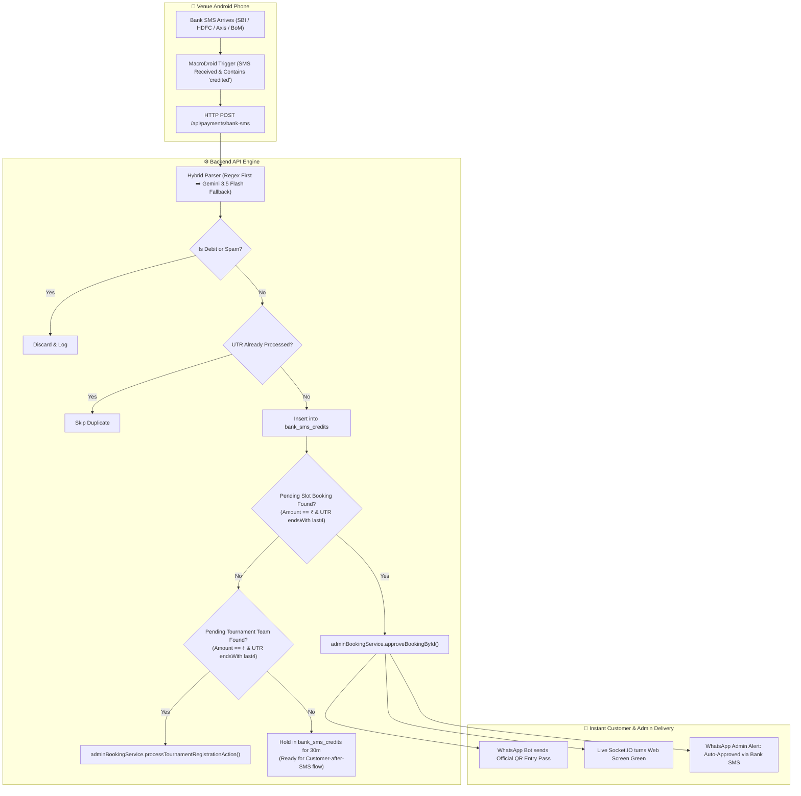

# 🏦 Bank SMS Auto-Verification Engine — Implementation Plan

> **Goal**: Fully automate the verification and approval of UPI turf payments within 2–3 seconds by parsing incoming bank credit SMS messages from the venue Android phone via MacroDroid, eliminating manual verification while ensuring 100% zero-hallucination accuracy.

---

## 🏗️ Architecture & Workflow



---

## 📋 Step-by-Step Implementation Roadmap

### Phase 1: Database Schema (`bank_sms_credits`)
Create a persistent ledger in Neon PostgreSQL to record every bank SMS credit and power the **2-way matching engine** (handling race conditions where the bank SMS arrives before the player types their UTR).

* **Target File**: `backend/models/bankSms.sql` (or executed via DB migration script)
* **Fields**:
  * `id`: UUID primary key
  * `amount`: `NUMERIC(10, 2)` (e.g. `700.00`, `900.00`, `1000.00`)
  * `utr_number`: `VARCHAR(50) UNIQUE` (Full 12-digit UPI reference)
  * `last4`: `VARCHAR(10)` (Last 4 digits for rapid indexed lookups)
  * `raw_sms`: `TEXT` (Audit trail of the exact bank SMS)
  * `sender`: `VARCHAR(50)` (e.g. `VK-SBIINB`, `AD-HDFCBK`)
  * `matched_booking_id`: `UUID REFERENCES bookings(id)` (null until matched)
  * `matched_registration_id`: `UUID REFERENCES tournament_registrations(id)` (null until matched)
  * `is_used`: `BOOLEAN DEFAULT FALSE`
  * `created_at`: `TIMESTAMP DEFAULT NOW()`
  * `expires_at`: `TIMESTAMP DEFAULT (NOW() + INTERVAL '30 minutes')`
* **Indexes**: `(amount, last4) WHERE is_used = FALSE` and `(utr_number)`.

---

### Phase 2: Hybrid Parsing Service (`bankSmsParser.js`)
Build a 2-tier extractor that is blazing fast, cost-free for 95% of standard SMS messages, and falls back to Gemini 3.5 Flash for non-standard regional bank templates.

* **Target File**: `backend/services/bankSmsParser.js`
* **Features**:
  1. **Strict Debit Filter**: Instantly discards messages containing `"debited"`, `"withdrawn"`, `"spent"`, or `"sent Rs"`.
  2. **Tier 1 (Regex Engine)**:
     * Captures credit keywords: `credited`, `deposited`, `received`.
     * Captures INR Amount: `(?:Rs\.?|INR|credited (?:with|by))\s*([\d,]+(?:\.\d{2})?)`.
     * Captures 12-digit UTR: `(?:UPI(?:\/|\s*ref|\s*txn)?[:\s\/-]*)(\d{12})`.
  3. **Tier 2 (Gemini 3.5 Flash Fallback)**:
     * If regex fails to extract both amount and 12-digit UTR, sends SMS text to Gemini with strict schema `{ isCredit: boolean, amount: number, utr: string, last4: string, bank: string }`.
  4. **Output Normalization**: Returns `{ success: true, isCredit: true, amount: 700, utr: "432187652715", last4: "2715", bank: "SBI" }`.

---

### Phase 3: Two-Way Matching Service (`bankSmsMatchingService.js`)
Handles both arrival orders with zero race conditions:

* **Target File**: `backend/services/bankSmsMatchingService.js`
* **Method 1: `processIncomingBankSms({ rawSms, sender })`** (SMS arrives after customer booking):
  1. Parses SMS. If debit or unparseable, exits safely.
  2. Inserts credit into `bank_sms_credits` (ignores duplicate UTR).
  3. Searches `bookings` table:
     ```sql
     SELECT id FROM bookings
     WHERE status = 'pending_verification'
       AND paid_amount = $1
       AND (utr_number = $2 OR $3 LIKE '%' || utr_number)
     ORDER BY created_at DESC LIMIT 1;
     ```
  4. If found:
     * Marks `bank_sms_credits.is_used = TRUE` and links `matched_booking_id`.
     * Calls `adminBookingService.approveBookingById({ bookingId, adminIdentifier: 'system_bank_sms' })`.
     * Emits real-time Socket.io event and sends customer entry pass on WhatsApp.
     * Sends Admin summary alert on WhatsApp.
  5. If no slot booking matches, searches `tournament_registrations` table. If matched, calls `adminBookingService.processTournamentRegistrationAction(...)`.
  6. If neither matches, credit remains stored in `bank_sms_credits` with `is_used = FALSE`.

* **Method 2: `checkCachedBankCreditForUtr({ amount, utr, last4 })`** (Customer submits after SMS has arrived):
  1. Called directly from `handleUtrSubmission` (WhatsApp) and `submit-upi` (Web).
  2. Checks:
     ```sql
     SELECT * FROM bank_sms_credits
     WHERE amount = $1
       AND (utr_number = $2 OR last4 = $3)
       AND is_used = FALSE
       AND expires_at > NOW()
     ORDER BY created_at DESC LIMIT 1;
     ```
  3. If found:
     * Immediately confirms the booking **on the spot** (status = `'confirmed'`, payment_status = `'paid'`).
     * Marks `is_used = TRUE`.
     * The customer skips the "Pending Verification" screen entirely!

---

### Phase 4: API Webhook Route (`backend/routes/payments.js`)
* **Endpoint**: `POST /api/payments/bank-sms`
* **Security & Flexibility**:
  * Authorized via `x-webhook-secret: trimurti_bank_secret_2026` OR `macrodroid` User-Agent.
  * Accepts raw text, JSON `{ sms, sender }`, and URL-encoded payloads.
  * Returns `{ success: true, matched: true|false, bookingId: "..." }`.

---

### Phase 5: Admin Alerts & Dashboard Badges
1. **WhatsApp Admin Notification**:
   * Sends dedicated alert to admin:
     > ⚡ ***AUTO-APPROVED VIA BANK SMS* 🏦**  
     > *Booking #A0846D8B (Harshvardhan, ₹700) automatically matched with bank credit (UTR: ...2715). Entry pass issued!*
2. **Admin Bookings Dashboard (`AdminBookings.tsx`)**:
   * Shows a distinctive badge: 🟢 **`Auto-Verified (Bank SMS)`** with a bank icon.
   * Tooltip displays the bank sender and verified UTR.

---

### 📱 MacroDroid Configuration Summary (For Venue Phone)

| Field | Configuration |
| :--- | :--- |
| **Trigger** | `SMS Received` (From Bank senders or Any Number) |
| **Constraint** | Message text contains `credited` OR `deposited` |
| **Action** | `HTTP Request` |
| **Method** | `POST` |
| **URL** | `https://shri-trimurti-fitness-club.onrender.com/api/payments/bank-sms` |
| **Content-Type** | `application/json` |
| **Header** | `x-webhook-secret: trimurti_bank_secret_2026` |
| **Body** | `{"sms": "[sms_body]", "sender": "[sms_number]"}` |

---

## 🧪 Testing & Verification Plan

1. **Synthetic Bank SMS Tests**:
   * Test SBI SMS: `"Your A/c ...1234 Credited by Rs 700.00 on 15Nov26 by UPI/432187652715/Ref..."`
   * Test HDFC SMS: `"Rs. 700.00 deposited in HDFC Bank A/c ...5678 on 15-NOV-26. Info: UPI-432187652715-NAME..."`
   * Test Bank of Maharashtra SMS: `"Rs 700.00 credited to A/c ...3456 by UPI ref 432187652715..."`
   * Test Debit SMS Rejection: `"Rs 500.00 debited from A/c ...1234 on 15Nov26..."` ➡️ Must be rejected.
2. **Unrelated Payment Isolation Test**:
   * Send SMS for ₹500 (unrelated) while ₹700 booking is pending ➡️ No match, zero impact.
   * Send SMS for ₹700 with different UTR (`8899`) while booking with UTR `2715` is pending ➡️ No match, zero impact.
3. **End-to-End Flow Test**:
   * Create slot reservation in `AWAITING_PAYMENT`.
   * Trigger bank SMS webhook with matching ₹700 and UTR.
   * Verify booking status automatically changes to `confirmed` and QR entry pass is emitted.
