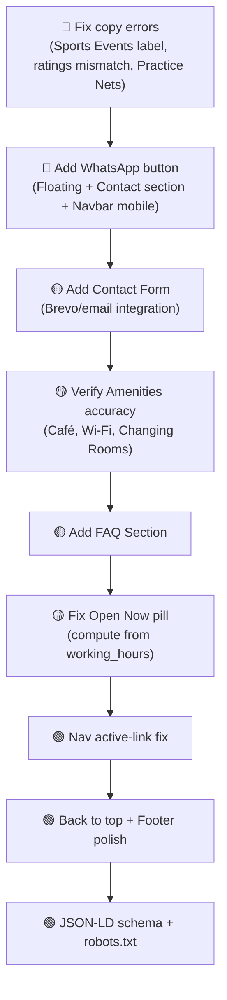

# Landing Page — Full Analysis & Improvement Suggestions

> [!NOTE]
> Review only — no changes implemented yet. Every suggestion below is a discussion point.

---

## Current Section Order

```
Navbar → Hero → UpcomingTournaments → Facilities → Features/Amenities
       → Pricing → Gallery → Testimonials → Contact → Footer
```

This is a reasonable flow. A few ordering and content changes below can lift conversion significantly.

---

## Section-by-Section Analysis

### 1. Navbar
**What it does well**
- Logo + wordmark, neon-green "Book Now" pill, dark/light toggle, animated mobile drawer — solid.

**Issues & suggestions**
| # | Issue | Fix |
|---|---|---|
| N1 | Active-link detection compares full `pathname` to hash links like `/#facilities` — these never match, so "Facilities" / "Pricing" / "Contact" nav pills are never highlighted. | Use `location.hash` to determine active state for hash links. |
| N2 | "My Bookings" is in the main nav — exposes it to anonymous visitors who have no bookings yet; creates confusion. | Move to a secondary area or only show when the user has an active session / booking cookie. |
| N3 | No WhatsApp / quick-call CTA in navbar for mobile. For a local sports arena, users on mobile want one-tap call before anything else. | Add a small phone/WhatsApp icon button on the mobile header row. |
| N4 | Navbar brand text "Shri Trimurti Sports **Arena**" is long and can wrap on small screens (320 px). | Shorten to just "Trimurti Arena" on mobile, or hide the text and show logo only on `< sm`. |
| N5 | Dark/light toggle is a great feature but the icon (`Sun`/`Moon`) is reversed — sun shows in dark mode (meaning "switch to light"), which is correct, but it's confusing UX. Consider adding a tooltip or label. | Add `title` attribute or tiny label "Light/Dark". |

---

### 2. Hero Section
**What it does well**
- Strong two-column layout, neon-green gradient headline, stat strip (10 000+ sessions, 4.9★, 6AM–12AM), animated entrance, real arena image — very good overall.

**Issues & suggestions**
| # | Issue | Fix |
|---|---|---|
| H1 | The stat strip value `10,000+` sessions is **hardcoded** — will look stale / fake as the platform grows. | Pull from `/stats` API or at least make it admin-editable via settings. |
| H2 | `4.9 ★` rating is hardcoded — different from the `4.6` shown in the Testimonials section Google banner. **Inconsistency**. | Use the same `settings.google_rating` from `/settings/contact` everywhere, or remove the stat-strip rating. |
| H3 | Supporting text says "pro netting systems" — the word "pro" is marketing filler. | Replace with something specific: "professional cricket nets", "flood-lit football arena", etc. |
| H4 | Only **one** image (hero-arena.jpg) is used — no visual differentiation between cricket and football. | Show a split card or alternating image carousel for cricket/football. |
| H5 | The "Open Now" pill inside the floating card is **always visible** regardless of actual working hours. | Either remove it or compute dynamically from `working_hours` from contact settings. |
| H6 | On mobile, `pt-28` top padding is generous — the first visible content is below the fold on many phones. | Reduce to `pt-20` or `pt-16` on mobile. |
| H7 | Hero CTA buttons are `flex-row` on all sizes — on 360 px screens both buttons can get very narrow. | Switch to `flex-col` on xs, `flex-row` on sm+. |

---

### 3. Upcoming Tournaments (Post-Hero)
**What it does well**
- Full-width cinematic banner, auto-rotation, sold-out badge, responsive — excellent feature.

**Issues & suggestions**
| # | Issue | Fix |
|---|---|---|
| T1 | Section returns `null` if no tournaments exist — this creates a jarring visual jump (Hero → Facilities with no separator). | Show a subtle "No tournaments scheduled" placeholder or a static "Tournaments coming soon" banner instead of hiding completely. |
| T2 | No entry fee displayed in the banner. Users want to know the cost before clicking. | Add `₹{entry_fee} Entry` badge alongside prize and teams. |
| T3 | The section has no `id` — it cannot be linked from navbar or footer. | Add `id="tournaments"` and add a "Tournaments" nav link. |
| T4 | Auto-rotate every 5 seconds — no pause on mobile scroll/touch. Users in mid-scroll see the content jump. | Pause auto-rotation when section is not in viewport. |

---

### 4. Facilities Section
**What it does well**
- Live data from API, alternating image+text rows, real facility type labels — solid.

**Issues & suggestions**
| # | Issue | Fix |
|---|---|---|
| F1 | Section title says **"Our Sports Events"** — this is semantically wrong. It should say "Our Facilities" or "Our Sports". | Change the `<p>` label to "Our Facilities". |
| F2 | Fallback `defaultImage` is a generic Unsplash sports photo — if a new facility type is added without an image it looks wrong. | Use an arena-branded placeholder instead. |
| F3 | The description falls back to a generic string `"Experience premium sports facilities..."` for any facility without a DB description. | Add proper descriptions in DB via admin panel. (Not a code fix — a data fix.) |
| F4 | No "slot availability" or "next available time" teaser here — users have to click through to find out if they can book tonight. | Add a small real-time "Available today" or "Fully booked" indicator per facility using a lightweight `/availability/today?facility=cricket` endpoint. |
| F5 | Images are `h-[280px] lg:h-[360px]` fixed height — on very large screens (1440px+) the rows look unbalanced. | Add `xl:h-[420px]` breakpoint. |

---

### 5. Features / Amenities Section
**What it does well**
- Clean 2×4 / 4×2 grid, hover glow, icon cards — good.

**Issues & suggestions**
| # | Issue | Fix |
|---|---|---|
| A1 | **"Café & Refreshments"**, **"Changing Rooms"**, **"Free Wi-Fi"**, **"Live Screens"** — if these don't actually exist in the arena, they're misleading and will create bad first impressions on-site. | Confirm with client which amenities are real, remove or mark "Coming Soon" the ones that aren't. |
| A2 | "Spacious parking area for **40+ vehicles**" — hardcoded number. | Make this admin-editable or verify accuracy. |
| A3 | The feature cards have no `id` and the section is `id="features"` — not linked in the footer's Quick Links. | Add "Amenities" or "Features" to footer Quick Links pointing to `/#features`. |
| A4 | Mobile 2-column layout: on 360 px phones the card text is very small (`text-xs`). Long descriptions get cramped. | Add a "show more" or just trim descriptions to ≤ 60 chars on mobile. |

---

### 6. Pricing Section
**What it does well**
- Live data from `/pricing` API, mobile horizontal scroll with snap, desktop grid, popular badge, loading skeleton — excellent.

**Issues & suggestions**
| # | Issue | Fix |
|---|---|---|
| P1 | Mobile scroll width calculation `scrollWidth / plans.length` doesn't account for the gap between cards, so dots and scroll position can be off-by-one. | Use `IntersectionObserver` per card instead of scroll math. |
| P2 | "Coming Soon" disabled button appears for plans with no `facility` — no explanation of when or what. | Add a tooltip or small text beneath: "New sport coming soon!". |
| P3 | No "peak/off-peak" price distinction shown — if the same facility has different rates at different hours this section doesn't reflect that. | Add a small note or separate row for peak pricing if applicable. |
| P4 | Plan subtitles (`plan.subtitle`) are from DB — make sure they're filled in admin panel (currently unclear). | Verify data completeness in admin. |

---

### 7. Gallery Section
**What it does well**
- Cloudinary-backed, video support, lightbox with keyboard nav, mobile peek scroller — very well-built.

**Issues & suggestions**
| # | Issue | Fix |
|---|---|---|
| G1 | Section returns `null` if no images — creates jarring gap between Pricing and Testimonials. | Show a static "Gallery coming soon" placeholder or at minimum a CTA to follow on Instagram. |
| G2 | Desktop `md:grid-cols-4` grid with `col-span-2 row-span-2` for large items can produce layout holes if images are in the wrong order. | Ensure admin places a "large" image first or last in each row. Document this in admin UI. |
| G3 | No alt-text enforcement — `alt_text` could be empty from admin. Screen readers break. | Add a fallback alt text in the `img` element: `alt={img.alt_text || 'Arena photo'}`. |
| G4 | Lightbox close button (`top-6 right-6`) can be hidden behind the browser's safe-area on notched phones. | Add `safe-area-inset-top` padding to the close button. |

---

### 8. Testimonials Section
**What it does well**
- Admin-toggle controlled (only shows if `show_testimonials=true`), infinite marquee, drag support, Google badge, review submission modal — comprehensive.

**Issues & suggestions**
| # | Issue | Fix |
|---|---|---|
| Te1 | Marquee is currently **4× duplicated** (`[...t,...t,...t,...t]`) — if there are many testimonials (> 10), this creates a very long DOM with 40+ cards. | Duplicate only twice (`[...t,...t]`), or use CSS-only marquee with `animation: scroll linear infinite`. |
| Te2 | Marquee animation uses `x: ["0%", "-50%"]` — this works only if `displayItems.length` is exactly double `testimonials.length`. With 4× duplication, the math may drift. | Align with actual duplication factor. |
| Te3 | The Google Trust Banner shows hardcoded fallback `"4.6"` and `"150+"` reviews when settings are null — these will show even before API loads. | Use `null` or loading state instead of showing potentially wrong data. |
| Te4 | The "Write a Review" button is below the section header but the marquee runs underneath — on mobile, the button can be hard to find after scrolling past the marquee. | Move the "Write a Review" button to **below** the marquee, or make it sticky/floating. |
| Te5 | No rating filter or sort on the marquee — negative reviews (1–2 stars) will scroll by visibly. | Filter to show only 4★+ in the marquee, or let admin curate (approve before display). |

---

### 9. Contact Section
**What it does well**
- Live data from `/settings/contact`, Google Maps embed, one-click directions, clean card layout.

**Issues & suggestions**
| # | Issue | Fix |
|---|---|---|
| C1 | **No contact form** — "Drop by, call, or send us a message" is in the subtitle, but there's no message form. Users have no way to send a message. | Add a simple `name + phone/email + message` form that sends to admin or emails via Brevo. |
| C2 | Map shows only if address is set. If admin hasn't set it yet, users see "Map will appear once address is set" — an ugly state in production. | Pre-fill the contact settings with the actual arena address in DB. |
| C3 | The WhatsApp contact is completely missing — for an Indian sports arena, WhatsApp is the #1 communication channel. | Add a WhatsApp number field to contact settings and show a "Chat on WhatsApp" button. |
| C4 | "Get Directions" CTA uses standard Google Maps directions — good, but no WhatsApp/call button nearby. | Add a prominent "📞 Call Now" and "💬 WhatsApp" row of buttons. |

---

### 10. Footer Section
**What it does well**
- Logo, social links from API, quick links, sports list, contact info — standard and functional.

**Issues & suggestions**
| # | Issue | Fix |
|---|---|---|
| Fo1 | "Practice Nets" is in the "Our Sports" list — this isn't a separate sport, it's part of Cricket Turf. | Remove "Practice Nets" or fold it into "Box Cricket Turf (with nets)". |
| Fo2 | Footer Quick Links don't include "Tournaments" or "Gallery" — both are sections on the page. | Add both links. |
| Fo3 | Copyright year `2026` is hardcoded. | Use `new Date().getFullYear()`. |
| Fo4 | No "Back to Top" button — after scrolling through a long page, mobile users have to scroll all the way back up. | Add a sticky "↑" button that appears after scrolling 400 px. |
| Fo5 | Footer makes a **duplicate API call** to `/settings/contact` — the Contact section above already fetched it. | Lift the contact data to a React Context (`ContactInfoContext`) shared by both sections. |

---

## Cross-Cutting Issues

### 🔴 Critical — Fix before go-live
1. **Hardcoded rating inconsistency** (H2) — Hero shows `4.9★`, Testimonials banner shows `4.6`. Pick one source of truth.
2. **"Our Sports Events" label on Facilities section** (F1) — plainly wrong copy.
3. **"Practice Nets" in footer sports list** (Fo1) — not an independent sport.
4. **WhatsApp missing everywhere** (C3) — #1 contact method in India.
5. **"Open Now" pill is always visible** (H5) — could mislead users late at night.

### 🟡 High Priority — Significantly improves conversion
6. **No contact form** (C1) — users who want to inquire (tournaments, groups) have no channel.
7. **No real-time slot availability hint** (F4) — biggest friction in a booking flow.
8. **Amenities accuracy** (A1) — verify café, changing rooms, Wi-Fi, live screens are real.
9. **WhatsApp/Call button in Navbar mobile** (N3) — zero-click conversion on mobile.

### 🟢 Low Priority — Polish
10. Active nav link detection for hash links (N1)
11. Scroll top padding on hero mobile (H6)
12. Gallery null state (G1)
13. Footer duplicate API call (Fo5)
14. Copyright year dynamic (Fo3)
15. Back to top button (Fo4)

---

## Missing Sections (Consider Adding)

| Section | Why It Matters |
|---|---|
| **"How It Works"** (3-step booking flow) | Reduces drop-off by showing the process: Choose sport → Pick slot → Pay online. 30 seconds of text saves 5 minutes of confusion. |
| **WhatsApp Floating Button** | A floating `💬 WhatsApp` pill fixed to bottom-right converts Indian mobile visitors better than any other CTA. |
| **Tournament History / Past Winners** | Builds credibility. Even 2–3 past events with photos creates social proof. |
| **FAQ Section** | Answers "What happens if it rains?", "Can I cancel?", "What do I bring?", "Is parking free?" — kills the top 5 support messages. |
| **"Why Choose Us" / USP Section** | A short strip (3–4 icons) differentiating from local competition: "Indoor Turf", "LED Floodlights", "Online Booking", "Professional Nets". |

---

## Theme & Visual Suggestions

### Current Theme
- **Background**: Near-black (`#0d1117` range)
- **Primary accent**: Emerald green (`#39FF14` neon / `hsl(142, 76%, 36%)`)
- **Secondary accent**: Lime (`hsl(84, 80%, 55%)`)
- **Font**: Inter + Space Grotesk

The dark + neon-green theme is strong and modern. It works well for a sports/gaming brand. **No complete overhaul needed** — targeted refinements only:

| Suggestion | Detail |
|---|---|
| Add **golden amber** as a third accent | Use `#fbbf24` (amber-400) for tournament/prize badges — brings warmth and signals "celebration". Currently amber is used inconsistently only in the Tournament section header. |
| Use the **logo's own colors** more consistently | Logo has an olive-gold tone — using it for section labels/dividers ties the brand together. |
| Increase **contrast** in light mode | Light mode primary text in some spots is `text-zinc-600` on `bg-white` — passes AA but barely. Push to `text-zinc-800`. |
| **Section dividers** are invisible | Each section flows into the next with no separator. Add a subtle horizontal rule or alternating `bg-card/50` background every other section — which the code already does inconsistently. Make it consistent. |
| **Typography hierarchy** | H1 and H2 both use `font-heading font-bold/extrabold` — they look similar. Differentiate: H1 biggest + extrabold, H2 large + bold, H3 medium + semibold. |

---

## SEO & Performance

| Issue | Recommendation |
|---|---|
| **LCP (Largest Contentful Paint)** | Hero image (`hero-arena.jpg`) is loaded lazily via bundled import — good for cache but should have `fetchpriority="high"` on the `` tag. |
| **No structured data** | Add `LocalBusiness` JSON-LD schema in `index.html` with name, address, phone, hours, sports. Improves Google rich results. |
| **No sitemap / robots.txt** | Add `public/sitemap.xml` and `public/robots.txt`. |
| **Social preview** | OG image is set, but `og:type` should be `business.business` for a local business. |
| **Multiple API calls on page load** | Hero + Facilities + Pricing + Testimonials + Gallery + Contact all fire API calls simultaneously on mount. Add a lightweight `/landing-data` aggregate endpoint or use `React.Suspense` + React Query for deduplication. |

---

## Recommended Implementation Priority


