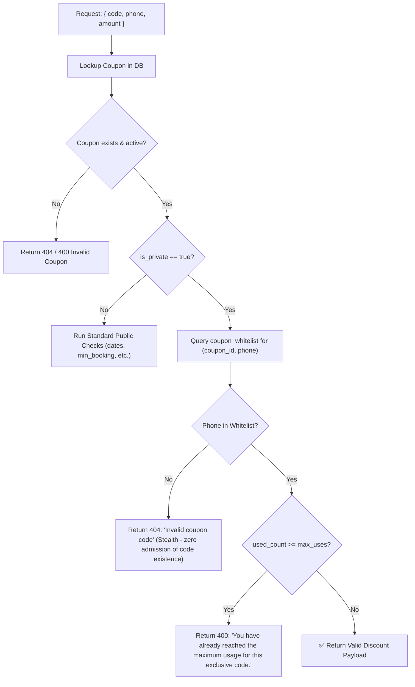

# Private VIP Coupon System: Stealth & Whitelist Architecture Plan

## 1. Executive Summary
The turf administration requires a two-tiered coupon system:
1. **Public Coupons (`is_private = false`)**: Visible in banners, welcome offers, or promo chips on the customer-facing booking page. Anyone with a valid match booking can redeem them according to standard rules.
2. **Private VIP Coupons (`is_private = true`)**: **100% invisible on all public UI, banners, and API endpoints**. They can **never** be browsed or discovered by regular customers. Only authorized 10-digit mobile numbers explicitly whitelisted by the turf admin can redeem them by manually typing/pasting the secret code shared directly with them (e.g. via WhatsApp or SMS).

---

## 2. Customer UI Experience: Strict Privacy & Zero-Leakage Policy

| Touchpoint | Public Coupon (`is_private = false`) | Private VIP Coupon (`is_private = true`) |
| :--- | :--- | :--- |
| **Welcome / First-Time Banner** | Automatically offered if eligible (e.g. `WELCOME100`). | ❌ **Never displayed** under any circumstances. |
| **"Available Offers" List / Chips** | Visible with terms (e.g. "₹100 OFF Cricket Turf"). | ❌ **Completely excluded** from all public offer APIs. |
| **Manual Code Entry Input** | User can type code and apply. | User manually types secret code shared by admin. |
| **Validation for Non-Whitelisted Player** | Standard rules apply (min order, date, etc.). | 🛑 **Stealth Rejection**: *"Invalid coupon code"* (never leaks to outsiders that the code exists). |
| **Validation for Whitelisted Player** | Standard rules apply. | ✅ **Success**: *"🎉 Exclusive VIP Offer Applied! Saved ₹X."* |

---

## 3. Admin UI Experience (`AdminCoupons.tsx`)

### A. Dedicated Section Tabs
At the top of the Coupons management dashboard:
- **All Coupons** (Total count)
- **🌐 Public Offers** (Visible on website)
- **🔒 Private / VIP Offers** (Secret codes strictly restricted to closed-group whitelists)

### B. Visual Distinction on Cards
- Public coupons display a clean **🌐 Public** badge.
- Private coupons display a prominent **🔒 Private VIP** badge with a count of authorized members (e.g., `👥 6 Whitelisted Members`).

### C. Create / Edit Modal: Whitelist Manager
When creating or editing a coupon:
1. **Visibility Radio / Switch**:
   - `🌐 Public` (Default)
   - `🔒 Private / Closed-Group (Hidden from website, whitelisted phone numbers only)`
2. When **Private** is activated, an intuitive **Whitelist Member Drawer / Panel** appears:
   - **Add Phone Number**: 10-digit mobile input with optional Nickname (e.g. `9876543210 (Rahul - Brother)`).
   - **Allowed Uses per Person**: Default `1x` (or custom, e.g. `3x`, `Unlimited`).
   - **Bulk Add**: Paste multiple phone numbers separated by commas or lines.
   - **Quick Add from Squads**: Search and pick frequent captains or registered players.
   - **Whitelisted Roster View**: Shows each member, their allocated uses, and how many times they have redeemed the code.

### D. 1-Click WhatsApp Direct Share
Beside each whitelisted member in the admin table/card, a dedicated **"Share via WhatsApp"** button:
```text
https://api.whatsapp.com/send?phone=919876543210&text=Hey%20Rahul!%20🏏%20Here%20is%20your%20exclusive%20private%20coupon:%20*FRIENDS200*%20for%20flat%20₹200%20OFF%20at%20Shri%20Trimurti%20Fitness%20Club.%20Valid%20on%20your%20number%20only!
```

---

## 4. Database Schema Design

### A. Update `coupons` Table
```sql
ALTER TABLE coupons 
  ADD COLUMN IF NOT EXISTS is_private BOOLEAN DEFAULT false;

CREATE INDEX IF NOT EXISTS idx_coupons_is_private ON coupons(is_private);
```

### B. New Table: `coupon_whitelist`
```sql
CREATE TABLE IF NOT EXISTS coupon_whitelist (
  id UUID PRIMARY KEY DEFAULT gen_random_uuid(),
  coupon_id UUID NOT NULL REFERENCES coupons(id) ON DELETE CASCADE,
  phone VARCHAR(10) NOT NULL,
  member_name VARCHAR(100),
  max_uses INT DEFAULT 1,
  used_count INT DEFAULT 0,
  created_at TIMESTAMP DEFAULT NOW(),
  updated_at TIMESTAMP DEFAULT NOW(),
  CONSTRAINT uq_coupon_whitelist_phone UNIQUE(coupon_id, phone)
);

CREATE INDEX IF NOT EXISTS idx_coupon_whitelist_lookup ON coupon_whitelist(coupon_id, phone);
```

---

## 5. Backend Logic & Security Matrix

### 1. `GET /api/coupons/check-first-time`
- Query explicitly filters: `WHERE is_private = false AND is_first_booking_only = true`.
- Guarantees private coupons never trigger on public first-time detection.

### 2. `POST /api/coupons/validate`


### 3. Booking Confirmation Hook (`POST /api/bookings` & Admin Confirmation)
- When a booking succeeds with an applied private coupon:
  - Atomically increment `coupon_whitelist.used_count` for `(coupon_id, phone)`.
  - Record the redemption in `coupon_redemptions`.
  - Increment global `coupons.used_count`.

---

## 6. Implementation Plan Checklist

1. **Database Migration**:
   - Create migration script `backend/migrations/add_private_coupon_whitelist.sql`.
   - Apply migration to PostgreSQL (Neon).

2. **Backend API Updates (`backend/routes/coupons.js`)**:
   - Filter out `is_private = true` from public lookups.
   - Implement whitelist CRUD endpoints for admin:
     - `GET /api/coupons/:id/whitelist`
     - `POST /api/coupons/:id/whitelist` (add single/bulk members)
     - `DELETE /api/coupons/:id/whitelist/:phone` (remove member)
   - Update `POST /api/coupons/validate` to enforce whitelist checks.
   - Update booking creation to track per-member `used_count`.

3. **Admin Frontend (`AdminCoupons.tsx`)**:
   - Add category tabs: **All**, **🌐 Public**, **🔒 Private VIP**.
   - Add `is_private` toggle and Whitelist Manager drawer to the Create/Edit modal.
   - Add mobile-responsive member list with WhatsApp 1-tap share links.

4. **Public Frontend (`BookingPage.tsx`)**:
   - Confirm private coupons cannot be listed or revealed.
   - Handle clear, friendly error feedback when unauthorized numbers attempt private codes.
