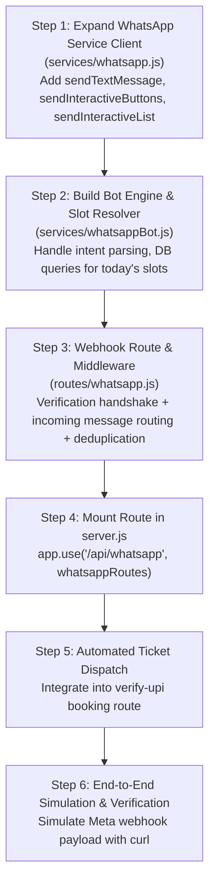

# Meta WhatsApp Cloud API Bot — Implementation Plan

> [!NOTE]
> **Objective**: Implement the complete WhatsApp Bot codebase in the backend first so it is 100% production-ready. Once you create your Meta Developer account later, you only need to paste your 3 environment variables into Render to go live.

---

## 1. System Architecture

```
                  ┌────────────────────────────────────────┐
                  │             Customer Phone             │
                  └──────────────────┬─────────────────────┘
                                     │ (1) WhatsApp message
                                     ▼
                  ┌────────────────────────────────────────┐
                  │         Meta Cloud API Server          │
                  └──────────────────┬─────────────────────┘
                                     │ (2) Webhook event (POST)
                                     ▼
        ┌────────────────────────────────────────────────────────────┐
        │                 Render Backend (Node.js)                   │
        │                                                            │
        │  routes/whatsapp.js ───► services/whatsappBot.js           │
        │                                 │                          │
        │         ┌───────────────────────┴───────────────────────┐  │
        │         ▼                                               ▼  │
        │  Intent Parser                              Live DB Engine │
        │  • Greeting & Buttons                       • Today's Slots│
        │  • Slot Check Handler                       • Pricing Plans│
        │  • Human Hand-off                           • Bookings Log │
        │         │                                               │  │
        │         └───────────────────────┬───────────────────────┘  │
        │                                 │                          │
        │  services/whatsapp.js (Meta Graph API Client)              │
        │  • sendTextMessage()                                       │
        │  • sendInteractiveButtons()                                │
        │  • sendInteractiveList()                                   │
        └─────────────────────────────────┬──────────────────────────┘
                                          │ (3) Instant HTTP POST
                                          ▼
                  ┌────────────────────────────────────────┐
                  │      Meta Delivers Reply to User       │
                  └────────────────────────────────────────┘
```

---

## 2. Core Bot Features to Implement

### Feature A: Welcome & Interactive Quick-Reply Menu
- **Trigger**: Customer texts anything (*"Hi", "Hello", "Hey", or clicks website WhatsApp button*).
- **Bot Action**: Sends a personalized greeting with 3 interactive action buttons:
  - Button 1: `🏏 Cricket Slots`
  - Button 2: `⚽ Football Slots`
  - Button 3: `💰 Pricing & Arena Rules`

### Feature B: Real-Time Slot Availability Check
- **Trigger**: Customer taps `🏏 Cricket Slots` or `⚽ Football Slots`.
- **Bot Action**:
  1. Queries Neon DB `slots` & `bookings` table for today's date.
  2. Filters out booked or expired hours.
  3. Formats clean list with pricing:
     > *"Available today on Cricket Turf:*  
     > *• 6:00 PM – 7:00 PM (₹600)*  
     > *• 8:00 PM – 9:00 PM (₹800 - Under Floodlights)*  
     > *• 10:00 PM – 11:00 PM (₹800)*  
     >  
     > *👉 Tap here to book online: https://yourdomain.com/book?facility=cricket"*
  4. If all slots are full: *"All slots are fully booked for tonight! Would you like to check tomorrow's schedule?"* with buttons `[Tomorrow's Slots]`, `[Talk to Staff]`.

### Feature C: Arena Info, Rates & Location
- **Trigger**: Customer taps `💰 Pricing & Arena Rules` or asks *"Where is it located?"* / *"Timing"*.
- **Bot Action**:
  - Sends exact pricing table (Cricket: ₹600/hr day, ₹800/hr night; Football: ₹800/hr).
  - Sends Google Maps location pin (`Kudire Factory, Sangrul Fata, Koparde`).
  - Sends operating hours (`10:00 AM – 12:00 AM daily`).

### Feature D: Human Staff Escalation (Hand-off)
- **Trigger**: Customer taps `[👤 Talk to Staff]` or types *"Call me"*, *"Manager"*, *"Tournament"*.
- **Bot Action**:
  1. Sets an active flag for that phone number in Redis / DB to pause auto-replies for 24 hours.
  2. Replies: *"I have notified our arena desk! Our manager will call or message you shortly on this number."*
  3. Sends an internal alert (or logs in audit log) with customer's phone number.

### Feature E: Automated WhatsApp Booking Confirmations (Outbound)
- **Trigger**: When admin confirms a booking in the Admin Dashboard (`PUT /api/bookings/:id/verify-upi`).
- **Bot Action**: Dispatches an official WhatsApp ticket to the player's phone with Booking ID, Facility, Slot Time, and arrival instructions.

---

## 3. Step-by-Step Code Execution Plan



### Step 1: Expand `backend/services/whatsapp.js`
Add support for the 3 core Meta Cloud API message formats:
1. `sendTextMessage(to, text, previewUrl)`
2. `sendInteractiveButtons(to, headerText, bodyText, footerText, buttonsArray)`
3. `sendInteractiveList(to, bodyText, buttonTitle, sectionsArray)`
- Keep resilient error handling: If Meta credentials are not yet configured in `.env`, it logs a clean mock response without crashing the server.

### Step 2: Create `backend/services/whatsappBot.js` (Bot Decision Engine)
- Function `processIncomingWhatsAppMessage({ from, messageType, text, buttonPayload })`:
  - Normalizes customer phone number.
  - Detects if customer pressed a button payload (`BTN_CRICKET_SLOTS`, `BTN_FOOTBALL_SLOTS`, `BTN_PRICING`, `BTN_STAFF`) or sent free text.
  - Queries `pool.query(...)` for live availability.
  - Generates the appropriate interactive response.

### Step 3: Upgrade `backend/routes/whatsapp.js`
- **GET `/api/whatsapp/webhook`**:
  - Validates `hub.mode === 'subscribe'` and `hub.verify_token === process.env.WHATSAPP_VERIFY_TOKEN`.
  - Returns `hub.challenge` with HTTP 200 (Meta's required handshake).
- **POST `/api/whatsapp/webhook`**:
  - Immediately acknowledges with `res.status(200).send('EVENT_RECEIVED')` (prevents Meta from retrying).
  - Asynchronously hands the message payload to `whatsappBot.processIncomingWhatsAppMessage()`.
  - Avoids duplicate processing via message ID (`wamid`) tracking.

### Step 4: Mount in `backend/server.js`
- Register `app.use('/api/whatsapp', whatsappRoutes)`.

### Step 5: Hook into Booking Verification
- In `backend/routes/bookings.js` (when admin approves a UPI payment), call `sendWhatsAppBookingConfirmation()` alongside Brevo email so the player gets both an email and a WhatsApp ticket!

### Step 6: Test Locally via Mock Payloads
- Use `curl` to simulate an incoming Meta webhook event to verify:
  1. Handshake response (`hub.challenge`).
  2. Greet message response.
  3. Live database query for cricket/football slots.

---

## 4. Environment Variables Needed (Later on Meta Account Setup)

| Key | Description | Example |
|---|---|---|
| `WHATSAPP_TOKEN` | Permanent System User Token from Meta Business Manager | `EAA...` |
| `PHONE_NUMBER_ID` | Meta's unique ID for your registered phone number | `105938472910482` |
| `WHATSAPP_VERIFY_TOKEN` | Secret passphrase you define for the webhook handshake | `trimurti_arena_secret_2026` |
| `WHATSAPP_WABA_ID` | WhatsApp Business Account ID | `102938475619283` |

---

## 5. Safety & Fallback Design
- **Zero-Downtime Guarantee**: If `WHATSAPP_TOKEN` is missing or invalid, the bot silently disables itself and logs a warning; it will **never** throw unhandled exceptions or crash the Render backend.
- **24-Hour Window Compliance**: Uses standard interactive messages for incoming customer chats (100% free under Meta's 1,000 monthly conversations tier).
