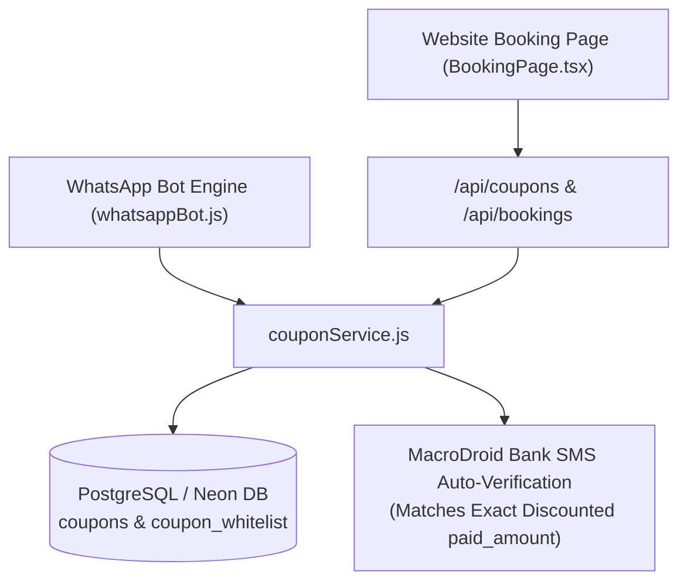
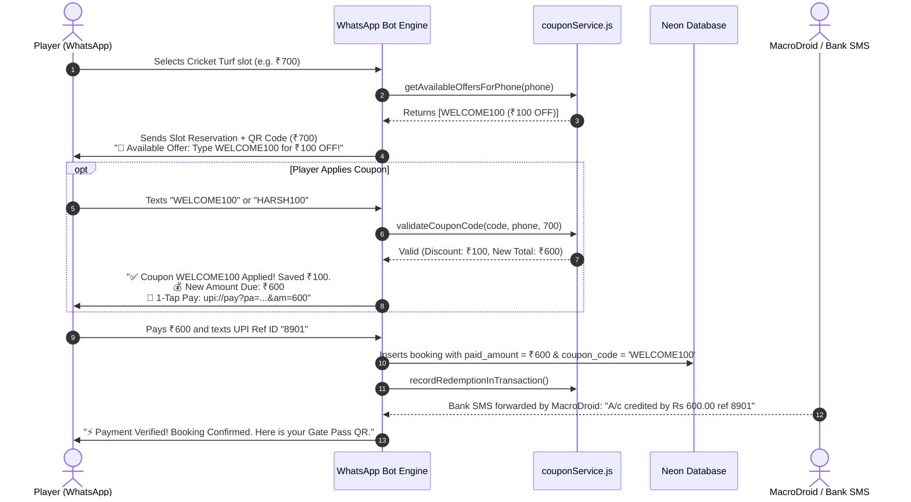

# WhatsApp Engine Coupon Integration Architecture Plan

## Executive Summary
This document outlines the architecture and execution plan to bring full coupon capabilities to the **WhatsApp Booking Engine** (`backend/services/whatsappBot.js`). 

Currently, players booking slots for **Cricket Turf** and **Football Turf** via WhatsApp only have access to Trimurti Coins loyalty points. This plan introduces native conversational support for:
1. **Public Coupons** (e.g. `WELCOME100` opening offer).
2. **First-Time Welcome Offers** (e.g. `WELCOME50` automatically detected for new phone numbers).
3. **Stealth Private VIP Coupons** (e.g. `HARSH100` for closed-group whitelisted numbers).
4. **Dynamic UPI QR & 1-Tap Links** recalculated instantly to the exact discounted amount.
5. **MacroDroid & Bank SMS Reconciliation** seamlessly auto-approving matches against the exact discounted payable price.

---

## Architecture: Shared Service Layer Pattern

To avoid code duplication and ensure identical validation rules across both the Web UI and WhatsApp Engine, we introduce a centralized [couponService.js](file:///home/harshvardhan/My%20People/HARSH/freelancing/ShriTrimurtiFitness/backend/services/couponService.js).

### Core Functions in `couponService.js`
* `getAvailableOffersForPhone({ phone, amount })`: Fetches valid public offers, automatically including first-time offers if the phone has 0 prior bookings, while strictly omitting private VIP coupons.
* `validateCouponCode({ code, phone, amount })`: Comprehensive validation engine:
  * Active status, start/end dates, global `total_usage_limit`, and player `per_user_limit`.
  * Minimum booking amount threshold (`min_booking_amount`).
  * First-time booking eligibility (`is_first_booking_only`).
  * Closed-group whitelist verification (`is_private`): Stealth check returning `"Invalid coupon code"` to outsiders.
  * Discount calculation with ₹300 turf operational price floor protection.
* `recordRedemptionInTransaction(client, { couponId, bookingId, phone, discountAmount })`: Atomically increments `used_count` in `coupons`, records entry in `coupon_redemptions`, and increments member `used_count` in `coupon_whitelist`.

---

## WhatsApp Conversational User Flow

---

## Detailed Conversational Scenarios

### Scenario 1: Applying Public Offer (`WELCOME100`)
1. **Bot Message upon slot reservation:**
   > 📋 **SLOT RESERVED (15 MINS)**  
   > 🏟️ **Turf:** Cricket Turf  
   > 📅 **Date:** Wed, 18 Nov | ⏰ **Time:** 6:00 PM - 7:00 PM  
   > 💰 **Amount Due:** **₹700**  
   >  
   > 🎉 **Available Offer:** Code **WELCOME100** gives **₹100 OFF**!  
   > 👉 *Reply with any promo code or secret VIP code to apply discount!*  
   > ⚡ *Or reply with your last 4 digits of UPI Ref ID to confirm.*

2. **Player texts:** `WELCOME100` (or `apply WELCOME100`)
3. **Bot replies immediately:**
   > 🎉 **COUPON WELCOME100 APPLIED!**  
   > 
   > 💸 **Discount:** -₹100  
   > 💰 **New Amount Due:** **₹600** *(was ₹700)*  
   > 
   > 📲 **Pay via UPI:**  
   > 👉 **UPI ID:** `harshvardhanp@slc`  
   > 👉 **1-Tap Pay:** `upi://pay?pa=harshvardhanp@slc&am=600&pn=Trimurti`  
   > 
   > ⚡ Reply with the **last 4 digits of your UPI Ref ID** (e.g. `8901`) to complete your discounted booking!  
   > *(Type "remove coupon" if you wish to cancel the discount).*

---

### Scenario 2: Whitelisted Friend Applies Private VIP Code (`HARSH100`)
1. **Player texts:** `HARSH100`
2. **Bot verifies:** Player's phone `7083738373` is in `coupon_whitelist` and has redemptions remaining (`used_count < max_uses`).
3. **Bot replies:**
   > 🔒 **EXCLUSIVE VIP OFFER APPLIED!**  
   > 
   > 🌟 **Harsh VIP Special:** -₹100  
   > 💰 **New Amount Due:** **₹600**  
   > 📲 **1-Tap Pay:** `upi://pay?pa=harshvardhanp@slc&am=600&pn=Trimurti`  
   > 
   > ⚡ Reply with your **last 4 digits of UPI Ref ID** to confirm.

---

### Scenario 3: Outsider Tries Private VIP Code (Stealth Rejection)
1. **Outsider texts:** `HARSH100`
2. **Bot verifies:** Coupon exists, but phone is NOT in `coupon_whitelist`.
3. **Bot replies stealthily:**
   > ⚠️ **Invalid coupon code.**  
   > Please check the spelling or proceed with payment of **₹700**.  
   > 
   > 📲 **1-Tap Pay:** `upi://pay?pa=harshvardhanp@slc&am=700&pn=Trimurti`  
   > Reply with your 4-digit UPI Ref ID to complete booking.

---

### Scenario 4: Combining with Trimurti Coins (Loyalty Points)
1. If the player has both a coupon and spendable Trimurti Coins:
   * Slot Price: ₹700
   * Coupon `WELCOME100`: -₹100
   * Coins (e.g. 50 coins): -₹50
   * **Final Payable:** ₹550 (abides by ₹300 arena price floor).
2. The bot recalculates the UPI pay link with `am=550`.
3. MacroDroid checks against `paid_amount = ₹550` for exact bank credit reconciliation.

---

## Implementation Touchpoints

| File | Changes Required |
| :--- | :--- |
| **`backend/services/couponService.js`** | New centralized service containing coupon fetching, validation, and atomic redemption persistence. |
| **`backend/services/whatsappBot.js`** | • In `initiateBooking`: Fetch available offers and inject promo note. • In `AWAITING_PAYMENT` listener: Add regex/keyword detector for coupon codes, call `couponService.validateCouponCode`, update `activeSession.price`, `activeSession.couponCode`, and send updated UPI link. • In `handleUtrSubmission`: Pass `coupon_code` and `discount_amount` to database and call `recordRedemptionInTransaction`. |
| **`backend/routes/coupons.js`** | Refactor `/validate` and `/public-offers` to delegate logic to `couponService.js` for DRY architecture. |
| **`backend/routes/bookings.js`** | Refactor checkout coupon validation in `submit-upi` to delegate to `couponService.js`. |

---

## Verification & Test Plan

1. **Unit Testing (`couponService.js`):**
   * Public coupon validation with minimum booking amount.
   * First-time welcome coupon eligibility vs existing customer exclusion.
   * Private VIP coupon authorization vs outsider stealth rejection.
   * Usage limit cutoff (global cap and per-user cap).
2. **WhatsApp Bot Simulation (`test_whatsapp_coupons.js`):**
   * Reserve Cricket Turf slot.
   * Simulate user sending `"WELCOME100"` -> Assert session price updates from ₹700 to ₹600.
   * Simulate outsider sending `"HARSH100"` -> Assert stealth error response and price unchanged.
   * Simulate whitelisted member sending `"HARSH100"` -> Assert session price updates.
   * Simulate user submitting 4-digit UTR -> Assert booking saved with `coupon_code` and `paid_amount = 600`.
   * Simulate MacroDroid bank SMS for ₹600 -> Assert instant auto-approval.
3. **Regression Testing:**
   * Verify website checkout (`BookingPage.tsx`) continues functioning seamlessly with shared service.
